# Agricultural Question Answering with Retrieval-Augmented QLoRA Fine-Tuning

**Challenge Task: Q&A Model Development - Evaluation Report**

---

## Executive summary

We built a question-answering system for farmers' agricultural questions from 15,000 human-written question-answer pairs, and
produced answers for 1,000 unseen questions. The final system has three parts:

1. **An exact-match router.** If an unseen question is identical to a training question (438 of 1,000), it returns the stored
   human answer for that question.
2. **A learned neighbour re-ranker.** It retrieves the 10 most similar training questions and re-orders them with a gradient-boosted
   model that predicts which stored answer will best match the true answer.
3. **A fine-tuned generator.** Qwen2.5-3B-Instruct, fine-tuned with QLoRA on all 12,825 training rows. It writes the answer while
   reading the top-2 re-ranked training Q&A pairs as references, with a decoding scheme that suppresses repetition loops.

On **all N = 1,500 hold-out questions** (none of which appear in training), the main results are:

| Measure | Copy nearest answer (original order) | Copy nearest answer (re-ranked) | Zero-shot model | **Final model** |
|---|---|---|---|---|
| ROUGE-L | 0.2171 | **0.2322** | 0.1371 | 0.2125 |
| BERTScore F1 | 0.8425 | 0.8454 | 0.8259 | **0.8499** |
| Answer-reference similarity (bge-m3) | 0.7767 | 0.7882 | 0.8207 | **0.8462** |

**The headline finding depends on the metric:**

- **On word overlap (ROUGE-L, BLEU), copying the top re-ranked training answer is the strongest system.** It beats the final model
  by 0.0197 ROUGE-L [95% CI 0.014, 0.026]. Against the plain nearest-answer copy (original retrieval order), the final model is level
  on ROUGE-L (-0.0045 [-0.0105, +0.0011], not significant).
- **On meaning (BERTScore, embedding similarity), the final model is the strongest system.** It is significantly better than both
  copy baselines (vs the re-ranked copy: +0.0045 BERTScore F1 [0.0031, 0.0059], better on 922 vs 566 questions; +0.058 embedding
  similarity [0.054, 0.062]), than the earlier fine-tuned model, and than zero-shot.
- **Copying works only when a near-duplicate question exists.** When the nearest training question differs from the one asked,
  copying answers the wrong question (for example, "karela seed rate" receives the answer for "carrot seed rate"). The model wins
  in that case on every metric, including ROUGE-L.

The submitted predictions use the router for the 438 exact repeats and the final model for the other 562 questions.

**How the numbers were produced.** Development experiments used a fixed sample of 300 hold-out questions (N = 300) or 50 (decoding
sweep). The final evaluation (notebook 11) re-scored every system on all 1,500 hold-out questions; on the shared 300 questions it
reproduced the earlier ROUGE-L of all six systems exactly. N is stated with every number.

---

## 1. Task, data and constraints

### 1.1 Task

- Build a Q&A model from a 15,000-pair agricultural training set (`training_set_15000.csv`: question, final answer, cited sources).
- Use a 90/10 train/test split and compare against at least one baseline.
- Produce answers for an unseen set of 1,000 questions (`unseen_set_1000.csv`). These are ranked with a **hidden metric that is not
  disclosed to us**.
- Deliver training notebooks, a separate inference notebook that loads the trained checkpoints, the predictions file, and this report.

### 1.2 Data facts that shaped the design

| Fact | Value | Consequence |
|---|---|---|
| Training pairs | 15,000 | |
| Groups of repeated questions in training (same normalised text) | 501 groups (largest: 15 rows) | identical questions must not cross the split |
| Unseen questions identical to a training question | **438 of 1,000 (43.8%)** | an exact-match router is worthwhile |
| ROUGE-L between two different human answers to the same question | **0.61** (0.6225 medoid, 0.6099 random other; 501 groups) | practical ceiling: even a perfect human answer scores ~0.6 |
| Reference answer length (hold-out) | median 417 words (p90 931, p95 1,155) | long outputs needed; generation budgets matter |
| Training answers containing templated repetition (an 8-word sequence 3+ times) | 1,458 of 15,000 (9.7%) | repeated structure is natural in the data |
| Unique cited source documents | 7,428 PDFs | a document-retrieval pipeline was attempted (Section 4.2) |

### 1.3 Compute

All training and inference ran on Kaggle (2 x NVIDIA T4, 16 GB each, 12-hour session limit). CPU work (analysis, diagnostics,
smoke tests of every notebook with a tiny random model) ran locally.

---

## 2. Evaluation protocol

- **Grouped split (seed 42):** train 12,825 / dev 675 / hold-out test 1,500 rows. Questions are grouped by normalised text (Unicode
  NFKC, lowercase, punctuation removed), and a whole group goes to one split, so **no question text appears in both training and
  test**.
- **Final evaluation: all 1,500 hold-out rows** (notebook 11). Every system is scored on exactly the same 1,500 questions.
- **Development sample:** while choosing designs, generated systems were scored on a fixed random sample of **300 of the 1,500
  hold-out rows** (seed 42), and the decoding sweep on 50. The sample is representative: the copy baseline scores 0.2146 ROUGE-L on
  it and 0.2171 on all 1,500, and the final model 0.2106 vs 0.2125. Hold-out questions were never used for training or tuning;
  the re-ranker and retrieval fusion were tuned on the separate dev split.
- **Lexical metrics:** ROUGE-1/2/L F1 (`rouge_score`, with stemming), BLEU (sacrebleu), and the mean answer/reference length ratio.
- **Fact-F1:** precision/recall of "agronomic facts" (number + unit expressions such as doses, rates and yields) shared with the reference.
- **Semantic metrics** (Section 4.12):
  - BERTScore F1 (roberta-large, layer 17, the library default for English), raw and baseline-rescaled
  - cosine similarity of bge-m3 embeddings between the whole answer and the whole reference (up to 2,048 tokens)
- **Significance:** paired bootstrap over questions (2,000 resamples, fixed seed), reported as the difference with a 95% confidence
  interval. A difference is called significant only when the interval excludes 0. "Wins a vs b" counts the questions on which each
  system scored higher (ties excluded).
- **Sample sizes** are stated with every number. Router numbers are measured on a different population (repeated training questions)
  and are always reported separately.

---

## 3. System overview

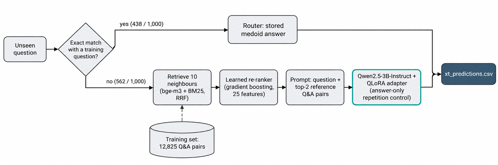

*Figure 1. System architecture. Exact repeats are answered by the router; all other questions go through retrieval, re-ranking and the fine-tuned generator.*

```
unseen question
  |- normalised text equals a training question? (438/1000)
  |     -> ROUTER: return the medoid (most representative) stored human answer of that question group
  |- otherwise (562/1000)
        -> RETRIEVE: 10 nearest training questions (bge-m3 dense + BM25, reciprocal-rank fusion)
        -> RE-RANK: gradient-boosted model over 25 features re-orders the 10 candidates
        -> PROMPT: system instruction + question + top-2 re-ranked training Q&A pairs as references
        -> GENERATE: Qwen2.5-3B-Instruct + QLoRA adapter v2, greedy decoding,
                     answer-only repetition penalty 1.1, no repeated 12-gram, max 1,280 new tokens
```

---

## 4. What we did, step by step: observations and decisions

Each step lists what we did, what we observed, and how that shaped the next decision.

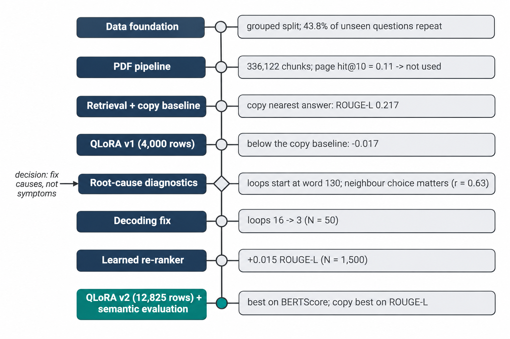

*Figure 2. Project timeline: each step and the observation that led to the next decision.*

### 4.1 Phase 0 - Data foundation

**Done:**
- Normalised questions and formed groups of identical questions.
- Chose a medoid answer for each group: the answer with the highest mean ROUGE-L to the group's other answers.
- Made the grouped split described in Section 2.
- Parsed the cited sources into document IDs and page ranges.
- Built one shared evaluation harness used by every system.

**Observed:**
- 43.8% of the unseen questions occur verbatim in training.
- Different human answers to the same question agree only at ROUGE-L ~0.61.
- **Strict leave-one-out estimate of the router** (notebook 00): hold out each answer of a repeated group, pick the medoid of the
  remaining answers, and score it against the held-out one. Medoid **0.6069** vs 0.6054 for a random remaining answer (1,112 held-out
  answers).

**Decision:** build an exact-match router for repeated questions, and use the medoid as its answer. The medoid is only marginally
better than any stored answer; the value of the router comes from returning a human answer to the same question (~0.61 ROUGE-L,
versus ~0.21 for any system on new questions).

### 4.2 Phase 1 - Source-document (PDF) pipeline

**Done:**
- Downloaded the 7,428 cited PDFs, with one process per file and a hard time-out, because a shared process pool froze on malformed files.
- Extracted text per page with PyMuPDF.
- Labelled page quality, including a detector for legacy-font (Kruti-Dev-style) garbled text.
- Chunked usable pages into 250-word windows with 50-word overlap.

**Observed (7,428 documents):**

| Outcome | Documents |
|---|---|
| good | 5,026 |
| scanned or empty (would need OCR) | 1,865 |
| garbled legacy font | 142 |
| Indic-script Unicode | 66 |
| mixed | 28 |
| HTTP 400 / not a PDF | 100 / 197 |

Result: **336,122 chunks from 5,118 documents.** Only 14,747 of 20,809 cited training pages (70.5%) exist as a chunk.

**Note on the two sets of labels.** The download notebook (01) labels each document while downloading. Its first legacy-font detector
was far too aggressive: it marked 5,173 documents as garbled and only 4 as good. The detector was then corrected (mid-word capitals
plus unusual symbols, with an exemption for chemical formulas), and notebook 02 recomputes every label from the saved page text. The
table above uses the recomputed labels. The download outcome itself (7,128 downloaded, 100 HTTP 400, 197 not a PDF, 3 time-outs or
404) is the same in both notebooks.

**Chunk retrieval quality** (BM25 + bge-small-en-v1.5 dense, weighted RRF), measured on questions whose cited pages exist as chunks
(944 page-level / 1,749 document-level questions):

| Method | page hit@1 | page hit@10 | document hit@10 |
|---|---|---|---|
| BM25 | 0.022 | 0.075 | 0.125 |
| dense (bge-small) | 0.040 | 0.109 | 0.194 |
| RRF fusion | 0.044 | 0.108 | 0.201 |

**Follow-up diagnostic (dev + test rows):**
- "Citation propagation" (using the pages cited by the nearest training questions) plus BM25 inside those documents raised page hit@10
  from 0.109 to **0.320** (document hit@10 from 0.204 to 0.437).
- **But even the gold cited pages contain only 26% of the reference answer's content words and 23% of its facts.** The two nearest
  training answers alone contain 35% and 19%.
- Adding two propagated pages to the neighbour answers raises fact coverage from 0.187 to 0.240, but roughly doubles the prompt
  (531 to 1,231 words).

**Decision:** document text was not used in the trained model. The reference answers are long advisories that go well beyond the cited
pages, a quarter of the documents have no extractable text, and the prompt-length cost was high. This is listed as a limitation and as
future work.

### 4.3 Phase 2 - Question retrieval and the copy baseline (B0)

**Done:**
- Encoded questions with bge-m3 (dense) and BM25 (sparse), fused with reciprocal-rank fusion (k = 20, dense weight 2).
- For every question, stored its 10 nearest training questions. A training question never retrieves its own group, so there is no
  leakage.

**Dev tuning** (ROUGE-L of the nearest neighbour's answer against the reference):

| Retrieval | random | BM25 | dense (bge-m3) | RRF fusion | oracle best-of-5 |
|---|---|---|---|---|---|
| top-1 ROUGE-L | 0.114 | 0.197 | 0.215 | 0.211 | 0.273 |

**Baselines on all 1,500 hold-out rows:**
- **B0a, copy the nearest training answer:** ROUGE-1 0.409, ROUGE-2 0.150, **ROUGE-L 0.217**, BLEU 0.141, fact-F1 0.168.
- B0b, medoid of the top-5 answers: ROUGE-L 0.213.

**Observed:** copying a neighbour's answer is already a strong baseline, because answers to similar questions share templates,
phrasing and dose formats.

**Decision:** use the retrieved Q&A pairs as references in the generator's prompt (retrieval-augmented generation), so the model can
reuse that structure and those facts.

### 4.4 Phases 3-4 - Baselines B1/B2 and the first QLoRA training (adapter v1)

**Model:** Qwen2.5-3B-Instruct. The model size was chosen to fit QLoRA training of ~1,600-token prompts on a 16 GB T4.

**Training recipe (used for every adapter):**
- 4-bit NF4 quantisation, fp16 compute
- LoRA rank 16, alpha 32, on all linear layers
- learning rate 2e-4 with cosine decay, effective batch 16
- loss on answer tokens only
- **RAFT-style distractors:** 20% of training prompts contain an irrelevant neighbour, so the model learns not to trust references blindly

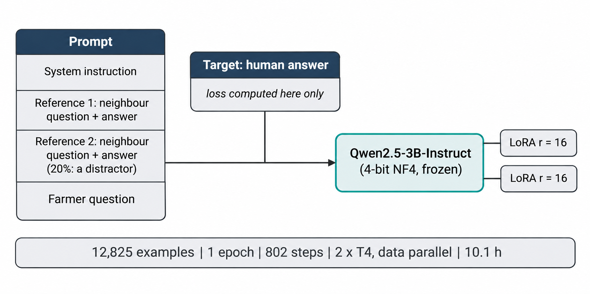

*Figure 3. One training example. Only the target answer tokens contribute to the loss; the 4-bit base model is frozen and only the LoRA adapters are trained.*

**Two adapters were trained in parallel (one per GPU) on 4,000 random training rows, 1 epoch (250 steps), max length 2,560 tokens:**

| Adapter | Prompt | Time | Dev loss (steps 100 / 200 / 250) |
|---|---|---|---|
| `none` (system B2) | question only | 2.6 h (38 s/step) | 1.604 / 1.556 / **1.553** |
| `nn` (system P1) | question + top-2 neighbour Q&A pairs | 5.8 h (83 s/step) | 1.494 / 1.450 / **1.448** |

266 of the 4,000 target answers (6.7%) were truncated at the length limit.

**Observed:** the lower dev loss with references (1.448 vs 1.553) shows that retrieval helps the model predict the answer.

**Decision:** 4,000 rows was the most that fitted one 12-hour session at 83 s/step. Full-data training was deferred until it could
be parallelised (Section 4.9).

### 4.5 Phase 5 - First full evaluation: a negative result

**Setup:**
- Hold-out N = 300.
- Greedy decoding, standard repetition penalty 1.05, at most 768 new tokens.
- Reference answers in the prompt trimmed to 380 tokens each.

| System | ROUGE-1 | ROUGE-2 | ROUGE-L | BLEU | Length ratio | Fact-F1 |
|---|---|---|---|---|---|---|
| B0a copy nearest answer | 0.407 | 0.149 | **0.215** | 0.138 | 0.97 | **0.162** |
| B1 zero-shot base model | 0.352 | 0.067 | 0.145 | 0.034 | 0.86 | 0.014 |
| B2 fine-tuned, no retrieval | 0.328 | 0.094 | 0.168 | 0.053 | 0.69 | 0.063 |
| P1 fine-tuned + retrieval | 0.375 | 0.125 | 0.197 | 0.079 | 0.73 | 0.118 |

**Paired bootstrap (ROUGE-L):**

| Comparison | Difference [95% CI] |
|---|---|
| P1 - B2 | +0.029 [+0.019, +0.040] |
| P1 - B1 | +0.053 [+0.043, +0.063] |
| **P1 - B0a** | **-0.017 [-0.030, -0.005]** |

**Observed:**
- Fine-tuning and retrieval each helped significantly.
- But the model scored **below simply copying the nearest answer.**
- 130 of 300 answers hit the 768-token cap, many inside a repetition loop.

**Decision point:** an obvious quick fix was to cut each output at the first repeated segment. **We rejected it as a patch that hides
the symptom.** Instead we diagnosed why the loops and the gap exist, and fixed the causes: decoding, retrieval quality, and the
amount of training.

### 4.6 Root-cause diagnostics (CPU, on the saved Phase 5 outputs, N = 300)

**Repetition loops** (an 8-word sequence repeated 3+ times):

| System | Answers with loops | Loop and hit the cap | Loop start (median word) |
|---|---|---|---|
| P1 fine-tuned + retrieval | 109 / 300 | 88 | 130 (IQR 74-238) |
| B2 fine-tuned, no retrieval | 99 / 300 | 65 | 96 |
| B1 zero-shot | 57 / 300 | 20 | 233 |
| P1 on the 562 unseen questions | 221 / 562 | 171 | 140 |

- **Loops start early** (median word 130, while the cap is ~495 words). So the cap is not the cause; the decoding is.
- **Fine-tuning increased looping** (57 to 99-109). The model imitates the 9.7% of training answers that contain templated repetition,
  and greedy decoding with a near-zero repetition penalty amplifies this.
- **Loops grow with reference length:** the loop rate is 0.24 for references under 250 words and 0.50 for references over 900 words.
  117 of 300 references are longer than the 768-token cap could hold.

**Retrieval headroom** (ROUGE-L of each of the 10 neighbours' answers against the reference):

| Neighbour rank | 1 | 2 | 3 | 5 | 10 |
|---|---|---|---|---|---|
| mean ROUGE-L | 0.215 | 0.201 | 0.192 | 0.174 | 0.163 |
| oracle best-of-k | 0.215 | 0.242 | 0.261 | 0.283 | **0.302** |

- The first-ranked neighbour is the best of the 10 for only **68 of 300** questions.
- The retrieval score correlates only **0.17** with how good the neighbour's answer is.
- But the quality of the top neighbour strongly predicts the quality of the generated answer (**r = 0.63**). For the best quartile of
  neighbours the model scores 0.257; for the worst, 0.157.

**Decisions:**
1. Fix decoding first, since it is cheap and needs no retraining (Section 4.7).
2. Improve which references the model sees: a learned re-ranker (Section 4.8).
3. Retrain on all data with a longer length limit, so fewer target answers are truncated (Section 4.9).

### 4.7 Decoding sweep (notebook 06; N = 50 hold-out questions, adapter v1)

**Key insight:** the standard Hugging Face repetition penalty and n-gram blocking also act on the *prompt* tokens. That stops the
model from copying wording and facts from its references, which is exactly what it should do. We implemented both controls as custom
logits processors that act **only on the generated answer**.

All 7 settings use a 1,280-token cap and the identical Phase 5 prompts:

| Config | Decoding | ROUGE-L | Fact-F1 | Hit cap | Loops | vs Phase 5 [95% CI] |
|---|---|---|---|---|---|---|
| Phase 5 (saved) | greedy, HF penalty 1.05, cap 768 | 0.1764 | 0.119 | 21 | 16 | - |
| B0a copy | - | 0.1987 | 0.149 | - | 5 | - |
| A | greedy, HF penalty 1.05 | 0.1733 | 0.115 | 14 | 14 | -0.003 [-0.013, +0.006] |
| B | greedy, HF penalty 1.15 (also penalises prompt words) | 0.1374 | 0.085 | 10 | 11 | **-0.039 [-0.057, -0.022]** |
| C | greedy, answer-only penalty 1.15 | 0.1744 | 0.139 | 8 | 3 | -0.002 [-0.018, +0.016] |
| D | greedy, HF penalty 1.05 + no repeated 12-gram | 0.1869 | 0.116 | 8 | 9 | **+0.011 [+0.003, +0.018]** |
| **E** | **greedy, answer-only penalty 1.1 + no repeated 12-gram** | **0.1898** | **0.147** | 5 | **3** | +0.013 [-0.0003, +0.029] |
| F | sampling T=0.7, top-p 0.9, HF penalty 1.05 | 0.1833 | 0.085 | 5 | 15 | +0.007 [-0.008, +0.022] |
| G | sampling + answer-only penalty 1.1 + no repeated 12-gram | 0.1877 | 0.133 | 3 | 2 | +0.011 [-0.005, +0.030] |

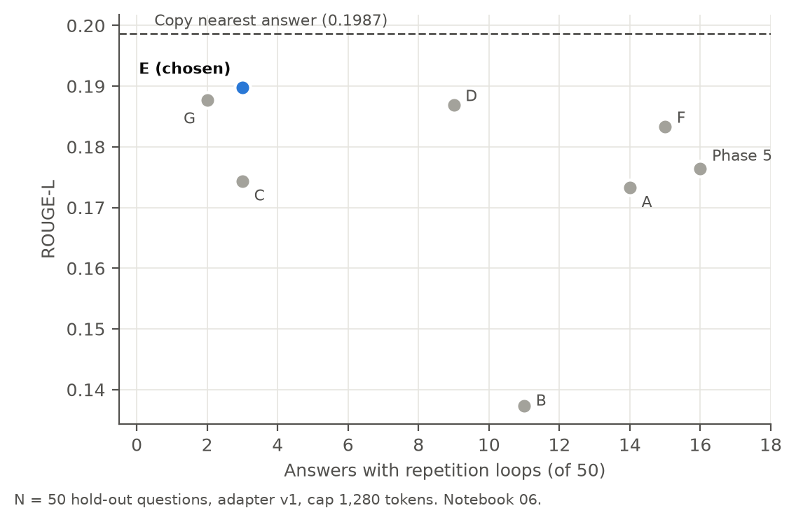

*Figure 4. Decoding sweep: ROUGE-L against the number of answers with repetition loops (N = 50, adapter v1). Setting E was chosen.*

**Observed:**
- Penalising prompt words (B) clearly hurts, which confirms the insight above.
- Setting **E** gives the best ROUGE-L and fact-F1 among the decoding settings, and cuts loops from 16 to 3.
- E's answers are shorter (median 325 words vs 400 for Phase 5).

**Decision:** adopt E for all generated systems in the final evaluation. N = 50 is enough to choose a setting, not to report a final
result, so every system was re-run with E on the full N = 300 (Section 4.10).

### 4.8 Learned neighbour re-ranker (notebook 07)

**Motivation:** Section 4.6 showed large headroom in *which* neighbour is used (oracle 0.302 vs top-1 0.215) and a strong link between
reference quality and answer quality.

**Done:**
- **Candidates:** the 10 retrieved neighbours of each query.
- **Label:** ROUGE-L of the candidate's answer against the query's true answer, relative to the query's mean.
- **25 features**, in four groups:
  - retrieval rank and score (and their gaps)
  - lexical overlap: Jaccard, IDF-weighted coverage, lengths
  - consensus: how similar a candidate's answer is to the other candidates' answers
  - group size, whether the candidate is a medoid, and two **cross-encoder** scores (bge-reranker-base: question-question and
    question-answer)
- **Models:** HistGradientBoosting (pointwise) and LightGBM LambdaRank, chosen on dev.
- **Training scores without leakage:** training queries were scored with **5-fold cross-fitting by question group**, so no training
  query is scored by a model that saw it.

**Results (top-1 = ROUGE-L of the first-ranked candidate's answer):**

| Ordering | Dev top-1 (n=675) | Test top-1 (n=1,500) | Test top-2 mean |
|---|---|---|---|
| retrieval order | 0.2221 | 0.2171 | 0.2058 |
| consensus only | 0.2147 | 0.2094 | 0.2053 |
| IDF question overlap only | 0.2131 | 0.2094 | 0.1992 |
| cross-encoder q-q only | 0.2072 | 0.1966 | 0.1921 |
| cross-encoder q-answer only | 0.2161 | 0.2150 | 0.2069 |
| **re-ranker, HistGradientBoosting (chosen on dev)** | **0.2369** | **0.2322** | **0.2224** |
| re-ranker, LightGBM LambdaRank | 0.2354 | 0.2372 | 0.2227 |
| oracle (best of 10) | 0.3029 | 0.3006 | 0.2657 |

- Test gain, re-ranked minus retrieval order: **+0.0152 [95% CI +0.0103, +0.0199]** (n = 1,500).
- On cross-fitted training queries: 0.2180 to 0.2335.
- Copying the re-ranked top answer also raises fact-F1 from 0.168 to 0.199 (n = 1,500).
- **No single signal beats the original retrieval order; only their learned combination does.**
- The top-1 candidate changed for 55% of training queries and 50% of test queries. The candidate *sets* are unchanged.

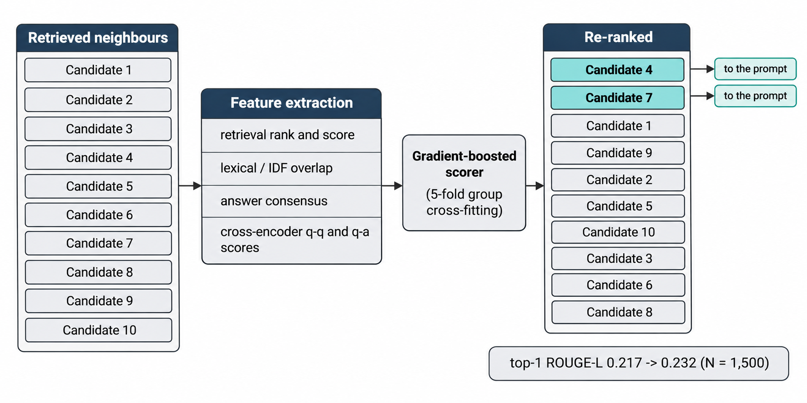

*Figure 5. Learned neighbour re-ranker. Top-1 ROUGE-L is the score of copying the first-ranked candidate's answer (N = 1,500).*

**Decision:** retrain the generator with re-ranked references, and add "copy the top re-ranked answer" as a new, stronger baseline.

### 4.9 Full-data retraining (notebook 08, adapter v2)

**Changes vs v1:**
- **All 12,825 training rows** instead of 4,000.
- References in re-ranked order.
- Max length 3,072 tokens: truncated targets fell from 6.7% to 2.8% (353 of 12,825).
- Same recipe as before (QLoRA, 20% distractors, effective batch 16).

**How it fitted in one Kaggle session:**
- Distributed data parallel across both T4 GPUs: 1 sequence per GPU x 8 accumulation steps x 2 GPUs.
- A pilot run on the 8 longest examples first verified memory and speed on 2 GPUs.
- A checkpoint every 25 steps and a time-limit guard (synchronised across GPUs) made the run resumable. In the end it finished in a
  single session.

**Run:**
- Completed 1 full epoch: **802 steps in 10.1 h** (45.3 s/step, average 1,610 tokens per example). No NaNs, no out-of-memory errors.
- Dev loss (60 dev examples):

| Step | 100 | 200 | 300 | 400 | 500 | 600 | 700 | 800 | 802 |
|---|---|---|---|---|---|---|---|---|---|
| dev loss | 1.463 | 1.404 | 1.369 | 1.342 | 1.322 | 1.310 | 1.303 | 1.302 | **1.302** |

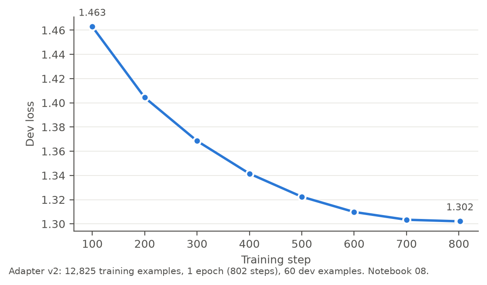

*Figure 6. Dev loss of adapter v2 during full-data training (60 dev examples).*

The v1 adapter ended at 1.448. The two dev sets and prompts differ, so this comparison only indicates direction; the hold-out evaluation
below is the actual comparison.

### 4.10 Evaluation of all systems on the development sample (notebook 09; N = 300; decoding E for every generated system)

These N = 300 results drove the decisions in Sections 4.11-4.12. The same systems were later re-scored on all 1,500 hold-out
questions (Section 4.13), which gives the final numbers.

| System | Model | References in the prompt |
|---|---|---|
| B0a (original) | none: copy the nearest training answer | - |
| B0a (re-ranked) | none: copy the top re-ranked training answer | - |
| B1 | Qwen2.5-3B-Instruct, zero-shot | none |
| B2 | adapter v1 `none` (4,000 rows) | none |
| P1 | adapter v1 `nn` (4,000 rows) | top-2, original order |
| **P2 (final)** | **adapter v2 (12,825 rows)** | **top-2, re-ranked** |
| P2 ablation | adapter v2 | top-2, original order |

| System | ROUGE-1 | ROUGE-2 | ROUGE-L | BLEU | Fact-F1 | Length ratio | Median words | Hit cap | Loops |
|---|---|---|---|---|---|---|---|---|---|
| B0a copy (original) | 0.407 | 0.149 | 0.2146 | 0.138 | 0.161 | 0.97 | 391 | - | 35* |
| **B0a copy (re-ranked)** | **0.430** | **0.167** | **0.2341** | **0.161** | **0.187** | 0.93 | 392.5 | - | 32* |
| B1 zero-shot | 0.348 | 0.061 | 0.1370 | 0.030 | 0.016 | 0.82 | 412 | 0 | 3 |
| B2 fine-tuned v1, no retrieval | 0.340 | 0.098 | 0.1671 | 0.061 | 0.056 | 0.73 | 358.5 | 60 | 19 |
| P1 fine-tuned v1 + retrieval | 0.395 | 0.138 | 0.2049 | 0.084 | 0.126 | 0.68 | 323 | 27 | 23 |
| **P2 final** | 0.415 | 0.145 | 0.2106 | 0.103 | 0.140 | 0.78 | 366.5 | 35 | 21 |
| P2 ablation (original order) | 0.420 | 0.145 | 0.2136 | 0.099 | 0.125 | 0.75 | 353.5 | 20 | 21 |

\* The copy baselines are human answers, so their "loops" are templated structure written by people. This shows that ~20 flagged
answers per 300 is the natural level for this data.

**Improvement of the generator on the same 300 questions:**

| Stage | ROUGE-L | Fact-F1 |
|---|---|---|
| Phase 5 model (P1, old decoding) | 0.197 | 0.118 |
| + decoding E (P1) | 0.205 | 0.126 |
| + full-data retraining and re-ranked references (P2) | 0.211 | 0.140 |

Answers hitting the cap fell from 130/300 (768-token cap) to 35/300 (1,280-token cap).

### 4.11 Can a gate choose between copying and generating? (CPU diagnostic; N = 300)

**Question:** since copying wins on ROUGE-L, could we pick, per question, whichever of the two is better?

**Observed:**
- The generated answer beats the copy on **137 of 300** questions, but by less (+0.045 on average) than the copy wins by on the others
  (+0.081).
- Choosing the better of the two with hindsight (an oracle) would give **0.255**.
- A logistic-regression gate using only information available at prediction time, evaluated with 10 x 10-fold cross-validation, could
  not exploit this:

| Gate features | ROUGE-L | vs always copying [95% CI] |
|---|---|---|
| all 11 features | 0.2304 | -0.0037 [-0.010, +0.002] |
| re-ranker confidence only | 0.2310 | -0.0031 [-0.008, +0.001] |
| agreement between generated and copied answer | 0.2334 | -0.0007 [-0.0013, -0.0002] (learns to always copy) |

The 11 features are: re-ranker score and margin, retrieval score, question overlap, answer agreements, lengths, cap and loop flags.

**Where generation loses on ROUGE-L:**

| Slice | Generated | Copy |
|---|---|---|
| Re-ranker most confident (top quartile; near-duplicate questions) | 0.254 | **0.312** |
| Re-ranker least confident (bottom quartile) | 0.178 | 0.183 (tie) |
| Generator hit the token cap (35 questions) | 0.159 | 0.239 |

**Decision:**
- Under ROUGE-L, a learned choice collapses to "always copy".
- Retraining the model to choose between copying and generating would therefore cost ~40 GPU hours: generating answers for all
  training questions to create labels, then retraining and re-evaluating. That is for a gain bounded by +0.021 (the oracle), and
  realistically much less.
- We first checked whether the conclusion even holds under a meaning-based metric (Section 4.12).

### 4.12 Semantic evaluation (notebook 10; N = 300; same saved answers)

**Why:** ROUGE and BLEU reward reusing human wording. They do not check whether an answer means the same thing, or whether it
addresses the question that was asked. Since the hidden ranking metric is unknown, we scored the same saved answers with
meaning-based measures. Before scoring, the notebook re-derived all 7 systems' answers and checked that their ROUGE-L equals the
notebook 09 results exactly.

| System | ROUGE-L | **BERTScore F1** | BERTScore F1 (rescaled) | Answer-reference similarity (bge-m3) |
|---|---|---|---|---|
| B0a copy (original) | 0.2146 | 0.8419 | 0.0631 | 0.7809 |
| B0a copy (re-ranked) | **0.2341** | 0.8458 | 0.0864 | 0.7904 |
| B1 zero-shot | 0.1370 | 0.8266 | -0.0273 | 0.8238 |
| B2 fine-tuned v1, no retrieval | 0.1671 | 0.8339 | 0.0158 | 0.8211 |
| P1 fine-tuned v1 + retrieval | 0.2049 | 0.8466 | 0.0911 | 0.8394 |
| **P2 final** | 0.2106 | **0.8496** | 0.1090 | 0.8478 |
| P2 ablation (original order) | 0.2136 | 0.8503 | 0.1129 | 0.8495 |

**Paired bootstrap, final model (P2) minus each comparison system** (N = 300; * = the CI excludes 0):

| Comparison | ROUGE-L | BERTScore F1 | bge-m3 similarity |
|---|---|---|---|
| vs copy (re-ranked) | -0.0235 [-0.035, -0.012] * | **+0.0038 [+0.001, +0.006]** * (wins 177 vs 120) | **+0.057 [+0.049, +0.066]** * (wins 227 vs 67) |
| vs copy (original) | -0.0040 [-0.015, +0.007] | **+0.0077 [+0.005, +0.011]** * | **+0.067 [+0.058, +0.076]** * |
| vs P1 (Phase 4 model) | +0.0057 [-0.002, +0.013] | **+0.0030 [+0.0004, +0.006]** * | **+0.008 [+0.003, +0.014]** * |
| vs B2 (no retrieval) | +0.0435 [+0.032, +0.055] * | +0.0157 [+0.012, +0.020] * | +0.027 [+0.020, +0.033] * |
| vs B1 (zero-shot) | +0.0735 [+0.063, +0.084] * | +0.0230 [+0.020, +0.026] * | +0.024 [+0.018, +0.030] * |
| vs same model, original order | -0.0030 [-0.009, +0.003] | -0.0007 [-0.003, +0.001] | -0.002 [-0.006, +0.003] |
| *re-ranked copy vs original copy* | +0.0195 [+0.008, +0.031] * | +0.0039 [+0.001, +0.007] * | +0.010 [+0.002, +0.017] * |

**When the copy answers a different question.** Questions are split into quartiles by the bge-m3 similarity between the asked question
and the training question whose answer is copied:

| Quartile (n ≈ 75 each) | Q1 (least similar) | Q2 | Q3 | Q4 (near-duplicate) |
|---|---|---|---|---|
| asked vs copied question similarity | 0.690 | 0.784 | 0.838 | 0.916 |
| ROUGE-L: final / copy | **0.197** / 0.193 | 0.197 / 0.208 | 0.198 / 0.223 | 0.251 / **0.311** |
| BERTScore F1: final / copy | **0.846** / 0.837 | **0.846** / 0.840 | **0.846** / 0.843 | 0.860 / 0.864 |
| final wins (BERTScore) | 65% | 62% | 55% | 53% |
| bge-m3 similarity: final / copy | **0.825** / 0.734 | **0.837** / 0.774 | **0.856** / 0.797 | **0.873** / 0.857 |

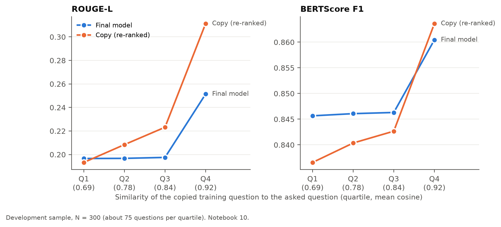

*Figure 7. Final model vs the re-ranked copy, by how similar the copied training question is to the asked one (N = 300). Copying only wins clearly on near-duplicates.*

Examples of the least similar copied questions (asked -> copied):

- "TELL ME KARELA SEED RATE" -> "What is the recommended seed rate for carrot?"
- "I want to maximize wheat yield. Can you suggest anything if I already have started sowing wheat?" -> "Give information about which
  vegetables we can sow at this time"
- "Which animal manure is best for which plant ...?" -> "What types of manure and fertilizers are recommended for wheat?"

**Caveats:**
- BERTScore reads at most 512 tokens, and 64% of the references are longer, so it judges mainly the opening of each answer. The bge-m3
  measure reads up to 2,048 tokens and agrees in direction.
- The bge-m3 similarity partly measures topical match: the zero-shot model (0.824) beats the copies on it. We therefore treat
  **BERTScore as the headline semantic metric**.
- We also computed question-answer relevance (the question vs the answer, no reference). It is **not used for conclusions**: it rewards
  restating the question, and the zero-shot model (0.766) scores above the human answers themselves (0.704).

**Decision:** the final model is the best system on meaning-based metrics, and the copy baseline is the best on word overlap. Because
the hidden metric is unknown, the copies visibly fail when the nearest question differs, and the brief asks for a model, **the submission
uses the final model for all non-repeated questions.** Before reporting, every system was re-scored on the full hold-out set (Section 4.13).

### 4.13 Final evaluation on the full hold-out set (notebook 11; N = 1,500)

**Why:** N = 300 was enough to choose designs, but several differences were small (for example, P2 - P1 on ROUGE-L was not
significant at N = 300). The final notebook therefore generated answers for **all six systems on all 1,500 hold-out questions**, plus
the 562 non-routed unseen questions, and scored everything with the lexical, fact and semantic metrics.

**How it was run (notebook 11, 2 x T4):**
- 6,562 generation jobs (4 checkpoints/settings x 1,500 hold-out questions + 562 unseen questions).
- **1,762 answers were reused** from notebook 09 (the 300-question sample for every system and the 562 unseen answers). Reuse was
  allowed only after checking that the checkpoint files (MD5 of the adapter weights), the decoding settings, the base model and the
  exact prompt text were identical; nothing was rejected.
- The other 4,800 answers were generated in 9.45 h across both GPUs; BERTScore and embedding scoring took 32 min.
- **Consistency check:** on the 300 questions shared with notebook 09, the ROUGE-L of all six systems is identical to notebook 09.

**Results (N = 1,500; reference median 416 words; fact-F1 averaged over the 1,342 references that contain at least one fact):**

| System | ROUGE-1 | ROUGE-2 | ROUGE-L | BLEU | Fact-F1 | BERTScore F1 | BERTScore (rescaled) | bge-m3 similarity | Length ratio | Median words | Hit cap | Loops |
|---|---|---|---|---|---|---|---|---|---|---|---|---|
| B0a copy (original order) | 0.409 | 0.150 | 0.2171 | 0.141 | 0.168 | 0.8425 | 0.067 | 0.777 | 1.01 | 421 | - | 171* |
| B0a copy (re-ranked) | **0.428** | **0.165** | **0.2322** | **0.158** | **0.199** | 0.8454 | 0.084 | 0.788 | 0.98 | 420 | - | 149* |
| B1 zero-shot | 0.347 | 0.060 | 0.1371 | 0.031 | 0.017 | 0.8259 | -0.032 | 0.821 | 0.83 | 414 | 2 | 18 |
| B2 fine-tuned v1, no retrieval | 0.339 | 0.097 | 0.1653 | 0.063 | 0.056 | 0.8325 | 0.007 | 0.821 | 0.75 | 368 | 284 | 107 |
| P1 fine-tuned v1 + retrieval | 0.392 | 0.135 | 0.2040 | 0.089 | 0.122 | 0.8464 | 0.090 | 0.838 | 0.72 | 333.5 | 142 | 110 |
| **P2 final** | 0.417 | 0.145 | 0.2125 | 0.104 | 0.139 | **0.8499** | **0.110** | **0.846** | 0.79 | 371 | 152 | 106 |

\* Human answers; their "loops" are templated structure written by people (Section 4.10).

**Paired bootstrap on N = 1,500** (difference [95% CI]; wins a vs b; * = the CI excludes 0):

| Comparison | ROUGE-L | BERTScore F1 | bge-m3 similarity |
|---|---|---|---|
| final - copy (re-ranked) | -0.0197 [-0.0256, -0.0140] * (762 vs 724) | **+0.0045 [+0.0031, +0.0059]** * (922 vs 566) | **+0.0580 [+0.0539, +0.0620]** * (1,142 vs 341) |
| final - copy (original order) | -0.0045 [-0.0105, +0.0011] (863 vs 627) | **+0.0074 [+0.0059, +0.0088]** * (985 vs 507) | **+0.0695 [+0.0653, +0.0737]** * (1,180 vs 306) |
| final - P1 (Phase 4 model) | **+0.0085 [+0.0050, +0.0118]** * (838 vs 652) | **+0.0035 [+0.0024, +0.0046]** * (832 vs 662) | **+0.0080 [+0.0056, +0.0103]** * (873 vs 614) |
| final - B2 (no retrieval) | +0.0472 [+0.0422, +0.0521] * | +0.0174 [+0.0156, +0.0192] * | +0.0253 [+0.0223, +0.0283] * |
| final - B1 (zero-shot) | +0.0754 [+0.0710, +0.0801] * | +0.0240 [+0.0228, +0.0254] * | +0.0256 [+0.0228, +0.0284] * |
| re-ranked copy - original copy | +0.0152 [+0.0103, +0.0199] * | +0.0029 [+0.0017, +0.0040] * | +0.0115 [+0.0081, +0.0148] * |
| P1 - original copy | -0.0131 [-0.0192, -0.0074] * | +0.0039 [+0.0025, +0.0053] * | +0.0615 [+0.0573, +0.0657] * |

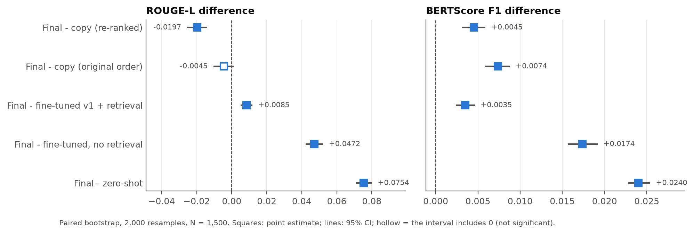

*Figure 8. Paired bootstrap differences, final model minus each comparison system, with 95% confidence intervals (N = 1,500).*

**Observed (what changed vs N = 300):**
- Every conclusion from N = 300 holds, and the intervals are about half as wide.
- **Retraining (P2 vs P1) is now significant on all three metrics**, including ROUGE-L (+0.0085). At N = 300 its ROUGE-L gain
  (+0.0057) was not significant. Since the order of the references made no difference (Section 4.12, N = 300), this gain comes from
  the retraining itself: 3.2x more data and a longer length limit.
- The final model ties the plain nearest-answer copy on ROUGE-L and beats it on both semantic metrics. Only the re-ranked copy,
  which uses our learned re-ranker, stays ahead on word overlap.
- On ROUGE-L the final model scores higher than the re-ranked copy on almost as many questions as it scores lower (762 vs 724); the
  copy's average lead comes from large wins on near-duplicate questions (Section 4.11).

---

## 5. Final results

### 5.1 Main table (all hold-out questions, N = 1,500; notebook 11)

| System | What it is | ROUGE-L | BLEU | Fact-F1 | BERTScore F1 | bge-m3 similarity |
|---|---|---|---|---|---|---|
| B0a copy nearest (original order) | copy the nearest training answer | 0.2171 | 0.141 | 0.168 | 0.8425 | 0.777 |
| B0a copy nearest (re-ranked) | copy the top re-ranked training answer | **0.2322** | **0.158** | **0.199** | 0.8454 | 0.788 |
| B1 zero-shot | Qwen2.5-3B-Instruct, question only | 0.1371 | 0.031 | 0.017 | 0.8259 | 0.821 |
| B2 fine-tuned, no retrieval | adapter v1 `none`, question only | 0.1653 | 0.063 | 0.056 | 0.8325 | 0.821 |
| P1 fine-tuned v1 + retrieval | adapter v1 `nn` (4,000 rows), top-2 references | 0.2040 | 0.089 | 0.122 | 0.8464 | 0.838 |
| **P2 final** | **adapter v2 (12,825 rows), top-2 re-ranked references** | 0.2125 | 0.104 | 0.139 | **0.8499** | **0.846** |

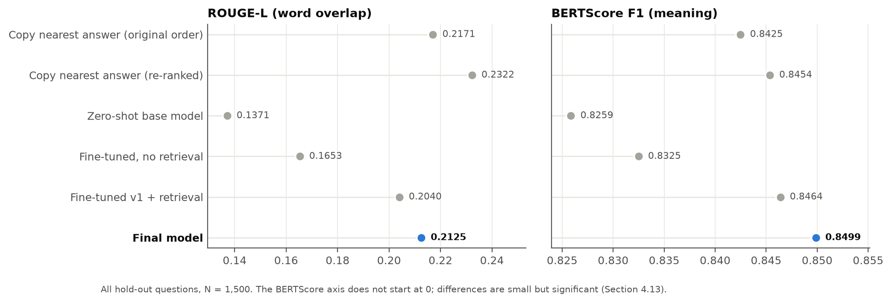

*Figure 9. All systems on word overlap (left) and meaning (right), N = 1,500. Copying the re-ranked answer leads on ROUGE-L; the final model leads on BERTScore.*

The development-sample version of this table (N = 300) is in Sections 4.10 and 4.12; every ranking is the same.

### 5.2 What each component contributed (paired bootstrap, 95% CI; significant unless marked n.s.)

| Component | Evidence | Effect |
|---|---|---|
| Fine-tuning + retrieval vs zero-shot | P2 - B1, N = 1,500 | +0.0754 ROUGE-L, +0.0240 BERTScore |
| Retrieved references in the prompt | P2 - B2, N = 1,500 | +0.0472 ROUGE-L, +0.0174 BERTScore |
| Decoding fix (answer-only penalties) | P1 at N = 300: 0.197 -> 0.205 ROUGE-L (same adapter, same questions); loops 16 -> 3 on N = 50 | modest gain, loops largely removed |
| Learned re-ranker (for copying) | B0a re-ranked - original, N = 1,500 | +0.0152 ROUGE-L, +0.0029 BERTScore, +0.0115 bge-m3 |
| Full-data retraining (+ re-ranked references) | P2 - P1, N = 1,500 | +0.0085 ROUGE-L, +0.0035 BERTScore, +0.0080 bge-m3 |
| Re-ranked vs original references for the generator | P2 - ablation, N = 300 | no effect on any metric (n.s.) |

### 5.3 The router (reported separately; not part of the hold-out numbers)

- Only repeated questions can be routed, so the router was measured on the **501 repeated question groups in training**: the stored
  medoid answer is compared with a *different* human answer to the same question.
- ROUGE-L **0.6225**, ROUGE-1 0.733, BLEU 0.592, fact-F1 0.664 (n = 501). Choosing a random other answer instead of the medoid gives
  0.6099.
- The medoid figure is slightly optimistic, because the medoid was chosen with the compared answer in the group. **0.6099 is the
  conservative figure.**
- The strict leave-one-out estimate from notebook 00 (the held-out answer is excluded when choosing the medoid) is **0.6069**
  (n = 1,112 held-out answers). All three figures agree that a routed answer scores about 0.61 ROUGE-L.

---

## 6. Predictions for the unseen set (`xt_predictions.csv`)

| Source | Questions | How the answer is produced |
|---|---|---|
| Router | 438 | the stored medoid human answer, verbatim. 435 questions are identical character-for-character; 3 differ only in case, punctuation or spacing. 396 of the matched questions have a single training answer; for the other 42 (41 with differing answers) the medoid is used. |
| Final model (P2) | 562 | generated with re-ranked references and decoding E. 51 hit the 1,280-token cap; 43 contain a repeated 8-word sequence. |

- The file has 1,000 rows in the original order of the unseen set, columns `question_id, question, final_answer`, and no empty answers.
- The submitted file is written by notebook 11 and is identical, row for row, to the one written by notebook 09 (1,000 of 1,000 rows).
- Notebook 11 also writes `test_predictions.csv`: the final model's answer for each of the 1,500 hold-out questions, next to the
  reference answer (`question_id, question, reference_answer, final_answer`), and `test_predictions_all_systems.csv` with all six systems.
- A companion file `xt_predictions_with_baseline.csv` adds a `baseline_answer` column: the same router, then the top re-ranked copied
  answer for the other 562.
- We do not report a blended score for the unseen set. Its references are hidden, and the router and generator are measured on
  different populations.

---

## 7. Discussion

### 7.1 Why copying wins on word overlap

1. **The metric rewards human wording.** Answers in this dataset share templates, phrases and dose formats. A neighbour's human answer
   overlaps the reference even when it answers a slightly different question.
2. **The data is full of near-duplicates.** When the nearest question is almost the same (top quartile, similarity 0.92), the copied
   answer reaches ROUGE-L 0.311 (N = 300 sample, ~75 questions per quartile).
3. **The generator learned to treat references as hints, not as text to reproduce.** During training, the best reference matched the
   target at only ~0.22-0.31 ROUGE-L, so copying never minimised the loss. The model learned a careful "average" answer instead. It
   paraphrases even near-perfect references, and its answers are shorter (length ratio 0.79 vs 0.98, N = 1,500).
4. **A 3B model trained for one epoch cannot memorise thousands of specific facts.** Fact-F1 is 0.139, versus 0.199 for copying
   (N = 1,500).

### 7.2 Why the model wins on meaning

The model always answers *the question that was asked*. The copy baseline answers the nearest training question, which is a different
crop, pest or intent for a sizeable share of questions. For the least-similar quartile (N = 300 sample), the model is better on every
metric, including ROUGE-L. On all 1,500 questions it is better than the re-ranked copy on BERTScore for 922 questions and worse for 566.

### 7.3 What worked and what did not

**Worked:**
- the grouped split (no leakage)
- retrieval-augmented fine-tuning
- answer-only decoding penalties
- the learned re-ranker
- multi-GPU training that fits all data in one session
- the exact-match router
- CPU smoke tests of every notebook before spending GPU time

- full-data retraining: small but significant gains on every metric (+0.0085 ROUGE-L, +0.0035 BERTScore; N = 1,500)

**Did not work, or was not worth it:**
- PDF context: weak coverage of the reference content
- better-ordered references for the generator (no effect; the re-ranker helps only the copy baseline)
- a learned copy-or-generate gate under ROUGE-L

---

## 8. Limitations

- **The hidden ranking metric is unknown.** Lexical and semantic metrics rank the systems differently, and we report both.
- **Some analyses use the 300-question development sample only:** the reference-order ablation, the copy-or-generate gate, the
  similarity-quartile analysis and the question-answer relevance check. The decoding sweep used 50 questions. All headline numbers use
  all 1,500 hold-out questions.
- **BERTScore truncates at 512 tokens**, and 64% of the references are longer.
- **The router's quality** is measured on repeated training questions, not on the unseen set.
- **Source documents:** 1,865 scanned PDFs were not OCR'd, and document text was not used by the final model.
- **The optional crop images** provided with the task were not used.
- **Training budget:** one epoch of QLoRA on a 3B model. Larger models or more epochs were not feasible on 2 x T4 within the time
  available.

## 9. Future work

1. **Teach the generator when to stay close to a reference.** Include a same-group answer as an "oracle reference" in part of the
   training data, and show the re-ranker's confidence in the prompt.
2. **Optimise directly for answer quality** with preference or reinforcement learning, using a semantic reward.
3. **Give the re-ranker the model's own answer as a candidate**, so selection and generation are learned jointly.
4. **Add OCR for scanned PDFs**, and train with propagated source pages for questions whose neighbours cite usable documents.

---

## 10. Reproducibility

| Notebook | Purpose | Kaggle run |
|---|---|---|
| 00_phase0_data_foundation | grouping, medoids, grouped split, citation parsing, evaluation harness | arth99/notebooka84a8ec33d |
| 01_download_extract_pdfs | PDF download and per-page text extraction | arth99/notebook83d26f8d88 |
| 02_quality_and_chunking | page quality labels, chunking | arth99/notebook2f606e19e8 |
| 03_retrieval_and_b0 | question/chunk retrieval, neighbour files, baseline B0 | arth99/notebooka19b5d78a2 |
| 04_train_qlora | adapters v1 `nn` and `none` (4,000 rows) | arth99/notebook0b1710bdcc |
| 05_inference_and_evaluation | first evaluation (Phase 5) | arth99/notebook8b327e810e |
| 06_decoding_sweep | 7 decoding settings, N = 50 | arth99/notebookfbc820415b |
| 07_rerank_neighbours | learned re-ranker | arth99/notebook3c63a00973 |
| 08_retrain_full | adapter v2 (12,825 rows, 2-GPU DDP) | arth99/notebookc8dc821345 |
| 09_final_inference_and_evaluation | all systems on the N = 300 sample, router, unseen predictions | arth99/notebookf1c39cfa36 |
| 10_semantic_evaluation | BERTScore and embedding similarity, N = 300 | arth99/notebook3d1cecfeec |
| **11_final_inference_full_test** | **inference notebook: loads the trained checkpoints, generates the unseen (Xt) and hold-out answers, all metrics on N = 1,500** | **arth99/notebookc8f7682267** |

All source code is in `src/`, and the notebooks are generated by `src/build_notebooks.py`, `src/build_nb10.py` and `src/build_nb11.py`.
Every number in this report comes from one of these saved files:
- `metrics.json` and `per_item_scores.csv` (notebook 11: all N = 1,500 results, router)
- `metrics.json` (notebook 09: N = 300 results)
- `semantic_metrics.json` (notebook 10)
- `sweep_results.json` (06)
- `rerank_report.json` (07)
- `train_summary.json` (04, 08)
- the CPU diagnostics `diag_retrieval.json`, `diag_generation.json`, `diag_gate.json`

### Hyperparameters

| Item | Value |
|---|---|
| Base model | Qwen/Qwen2.5-3B-Instruct |
| Quantisation | 4-bit NF4 (bitsandbytes), fp16 compute |
| LoRA | r 16, alpha 32, all linear layers |
| Optimisation | lr 2e-4, cosine schedule, effective batch 16, 1 epoch |
| Max sequence length | v1: 2,560; v2: 3,072 |
| Training rows | v1: 4,000; v2: 12,825 |
| Distractor (RAFT) rate | 20% |
| References in prompt | top-2 neighbour Q&A pairs |
| Decoding (final) | greedy, answer-only repetition penalty 1.1, no repeated 12-gram in the answer, max 1,280 new tokens |
| Question retrieval | bge-m3 dense + BM25, RRF k 20, dense weight 2, 10 candidates |
| Re-ranker | HistGradientBoosting, 25 features incl. bge-reranker-base cross-encoder scores, 5-fold group cross-fitting |
| Semantic metrics | BERTScore roberta-large (layer 17), bge-m3 cosine (max 2,048 tokens) |

---

## Appendix A - How the figures were produced

- **Charts (Figures 4 and 6-9)** are drawn by `src/make_figures.py` directly from the saved result files (notebook 11 `metrics.json`,
  notebook 10 `semantic_metrics.json`, notebook 08 `train_summary.json`, notebook 06 `sweep_results.json`). No number in a chart is
  typed in by hand.
- **Diagrams (Figures 1-3 and 5)** were drawn from the specifications below (Mermaid sources; `src/make_diagrams.py` renders
  them directly), and every label and number was checked against this report.
- Colours: blue marks the final system; orange marks the copy baseline where the two are compared directly; other systems are grey.

### Figure 1 - System architecture

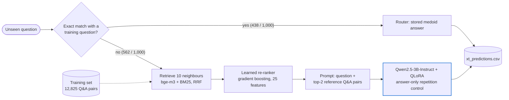

### Figure 2 - Project timeline and decisions

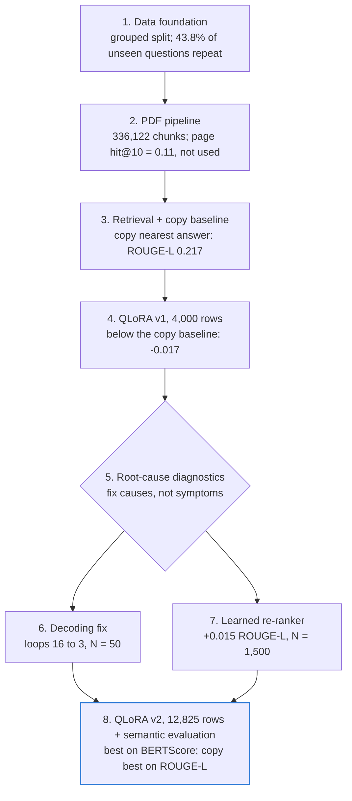

### Figure 3 - Training example construction and QLoRA

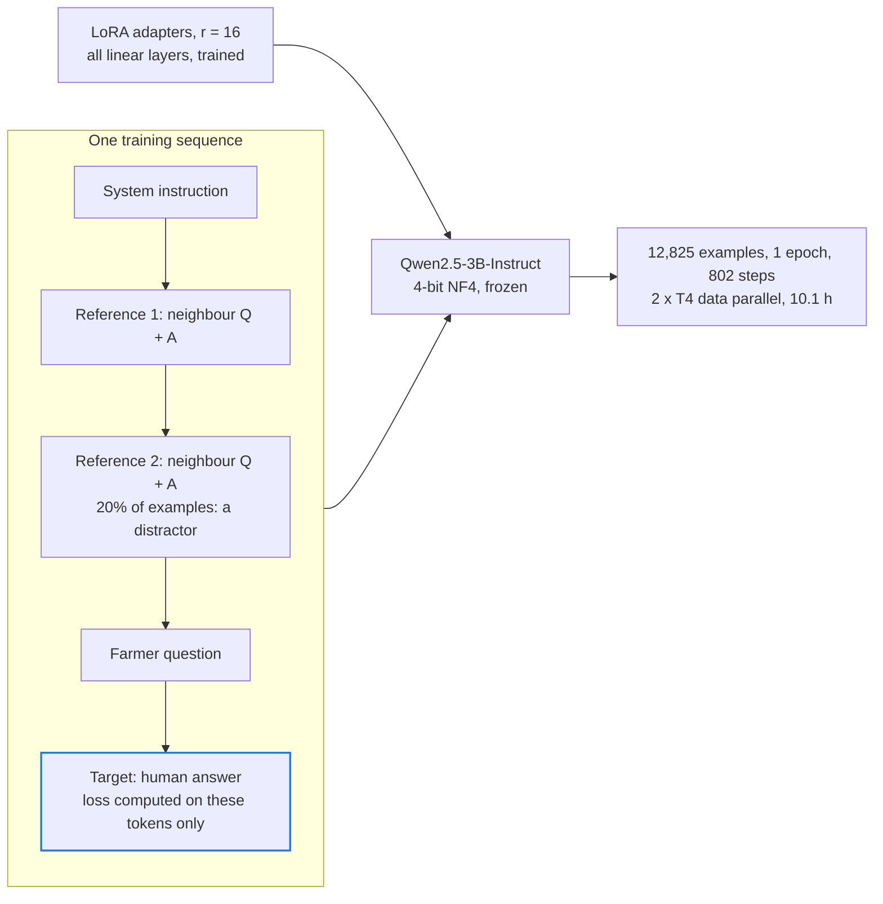

### Figure 5 - Neighbour re-ranker

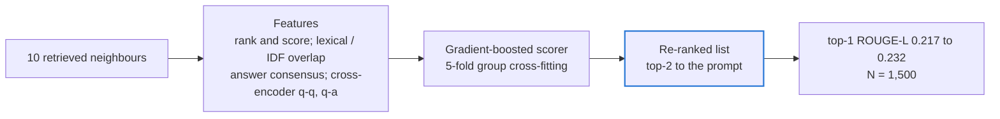

---

## Appendix B - Submission contents

| Required item | File(s) |
|---|---|
| Kaggle notebook code | `executed_notebooks/` (the notebooks as run on Kaggle, with outputs; file names start with the notebook number and end with the Kaggle ID), the clean sources in `notebooks/`, and `src/` |
| Evaluation report on the training dataset | this report (`REPORT.md` / `REPORT.pdf`) |
| Updated CSV of the test queries (Xt) with responses | `xt_predictions.csv` (1,000 rows: `question_id, question, final_answer`) |
| Separate notebook that loads the final checkpoints and generates responses for Xt and the test set | `notebooks/11_final_inference_full_test.ipynb`; its outputs `xt_predictions.csv` and `test_predictions.csv` (1,500 hold-out questions) |

Notebook 11 needs the trained adapters (`nlp-qna-adapters` dataset and the notebook 08 output), `train_processed.csv`,
`test_processed.csv` and the two neighbour files. Without a previous output attached it generates every answer itself: about 12 h of
generation on 2 x T4 for all six systems, of which the final model's 2,062 answers (Xt and test set) are about 4 h. If the 12-hour
session limit stops it, attaching its own output and running it again resumes where it stopped (only verified answers are reused).
